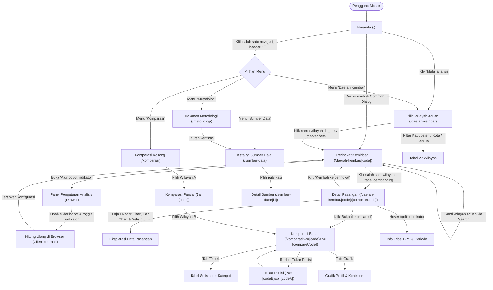
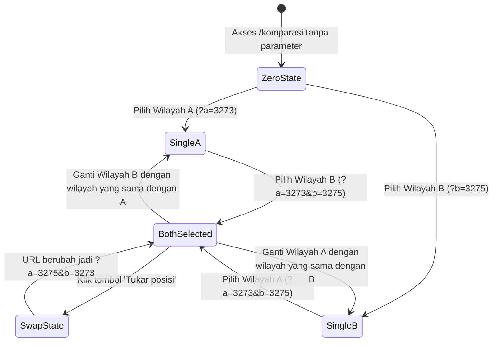
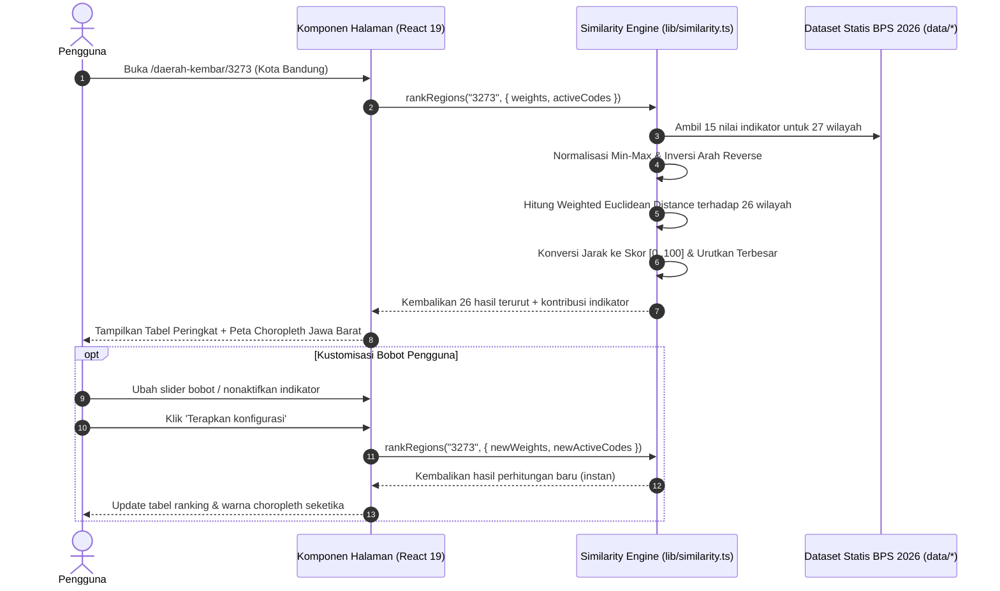

# DAERAH KITA — Alur Pengguna dan Interaksi Website (Website Flow)

Dokumen ini mendefinisikan peta situs, alur pengguna (*user journeys*), siklus data, hierarki navigasi, dan penanganan kondisi batas (*edge cases*) pada platform analitik publik **DAERAH KITA**.

---

## 1. Filosofi dan Prinsip Alur

Platform **DAERAH KITA** dirancang sebagai alat kerja analitik data publik (*data-driven decision support*), bukan portal pemasaran atau agregator berita. Seluruh alur navigasi mengedepankan prinsip:

1. **Evidence-First & Data Provenance:** Setiap angka yang tampil pada antarmuka berasal langsung dari dataset resmi BPS Jawa Barat (*Provinsi Jawa Barat Dalam Angka 2026*, data periode 2025/2026). Tidak ada estimasi fiktif.
2. **Explainable Similarity:** Skor kemiripan tidak disajikan sebagai kotak hitam (*black box*). Dari halaman peringkat, pengguna dapat menelusuri kontribusi setiap indikator, selisih riil, hingga formula matematis dan sumber tabelnya.
3. **Pesan Etika Data Konsisten:** Skor kemiripan mengukur kedekatan karakteristik statistik multivariat, **bukan peringkat prestasi, kualitas pembangunan, atau penilaian kinerja kepala daerah**. Pesan penegasan ini dihadirkan di setiap titik sentuh analitik (beranda, ranking, komparasi, metodologi).
4. **Alur Fleksibel & Dapat Dibagikan (*Shareable State*):** Pengguna dapat mulai dari beranda, langsung mencari wilayah via *command dialog*, menyesuaikan bobot analisis, atau membagikan tautan komparasi dua wilayah melalui parameter URL (`?a=...&b=...`).

---

## 2. Arsitektur Rute dan Peta Situs

Aplikasi dibangun di atas Next.js App Router dengan struktur rute hierarkis berikut:

| Rute URL | Nama Halaman | Tipe Render | Komponen Kunci | Peran & Deskripsi |
| :--- | :--- | :--- | :--- | :--- |
| `/` | **Beranda** | Server / Client | `HeroSection`, `JabarChoropleth`, `RegionSearch`, `PreviewSection` | Titik masuk utama, pengenalan platform, ringkasan capaian, dan pencarian cepat wilayah. |
| `/daerah-kembar` | **Pilih Wilayah Acuan** | Client Component | `RegionPicker`, `RegionMarkerMap`, `RegionSearch`, `ToggleGroup` | Direktori 27 kab/kota Jawa Barat dengan filter tipe wilayah dan peta sebaran titik pusat. |
| `/daerah-kembar/[code]` | **Peringkat Kemiripan** | Dynamic / Client | `RankingView`, `JabarChoropleth`, `AnalysisSettings`, `RegionSearch` | Peringkat 26 wilayah pembanding terhadap 1 wilayah acuan terpilih, visualisasi choropleth, dan pengubah bobot indikator. |
| `/daerah-kembar/[code]/[compareCode]` | **Detail Kemiripan Pasangan** | Dynamic / Client | `DetailView`, `CategoryRadarChart`, `ContributionBarChart`, `TwoRegionMap` | Perbandingan mendalam dua wilayah tertentu: selisih 15 indikator, grafik radar 5 kategori, kontribusi pembeda, dan peta spasial. |
| `/komparasi` | **Komparasi Bebas Head-to-Head** | Client (Suspense) | `ComparisonView`, `RegionSearch`, `TwoRegionMap`, `Tabs` | Perbandingan langsung dua wilayah bebas via URL search params (`?a=...&b=...`), fitur tukar posisi (*swap*), dan tab tabel vs grafik. |
| `/metodologi` | **Metodologi & Formula** | Server Component | `MetodologiPage`, formula math blocks, tabel verifikasi mandiri | Penjelasan 6 langkah matematis (Min-Max, Reverse, Weighted Euclidean, konversi skor, kontribusi) dan batas metodologi. |
| `/sumber-data` | **Katalog Sumber Data** | Server Component | `SumberDataPage`, tabel publikasi, tabel indikator | Inventaris 3 instansi penerbit resmi, 1 publikasi induk BPS, dan 15 indikator terdata lengkap. |
| `/sumber-data/[id]` | **Detail Publikasi Data** | Static / Server | `SumberDetailPage`, metadata teknis, tabel indikator terkait | Rincian lengkap instansi, tahun rilis, tanggal akses, tautan dokumen resmi BPS/Dinkes/Open Data Jabar. |

---

## 3. Diagram Alur Sistem dan Pengguna

### 3.1 Diagram Alur Pengguna End-to-End

---

## 4. Rincian Alur per Halaman

### 4.1 Beranda (`/`)

* **Tujuan:** Memperkenalkan premis analitik platform, mematahkan asumsi bahwa wilayah mirip hanya ditentukan oleh jarak geografis, dan menyediakan akses instan ke penelusuran wilayah.
* **Elemen & Tata Letak:**
  1. **Hero Section:**
     * Judul editorial: *"Temukan daerah kembarmu"*.
     * Call-to-action ganda: Tombol *"Mulai analisis wilayah"* (menuju `/daerah-kembar`) dan tombol pencarian instan *"Cari wilayah"* (membuka modal `RegionSearch`).
     * Peta Choropleth Jawa Barat (`JabarChoropleth`): Menampilkan rata-rata skor kemiripan masing-masing dari 27 kab/kota terhadap seluruh daerah lainnya.
     * Pesan etika data: Penegasan bahwa skor kemiripan bukan peringkat kualitas pembangunan.
  2. **Bagian 01 / Kemampuan (`CapabilitiesSection`):** Tiga pilar analitik (Similarity-based, Explainable metrics, Transparent data provenance).
  3. **Bagian 02 / Contoh Hasil (`PreviewSection`):** Studi kasus nyata Kota Bandung terhadap 5 wilayah paling mirip berdasarkan data resmi BPS Jawa Barat, lengkap dengan cuplikan indikator yang paling mendekati dan paling berbeda.
  4. **Bagian 03 / Cara Kerja (`HowItWorksSection`):** Ringkasan alur metodologi 3 langkah (Normalisasi, Pengukuran Jarak, Konversi Skor) dengan tautan langsung ke `/metodologi`.

---

### 4.2 Pemilihan Wilayah Acuan (`/daerah-kembar`)

* **Tujuan:** Memberikan direktori terstruktur 27 kabupaten/kota di Jawa Barat agar pengguna dapat memilih satu daerah acuan analisis.
* **Prekondisi:** Pengguna belum menentukan wilayah acuan atau ingin menelusuri katalog wilayah Jawa Barat.
* **Alur Interaksi:**
  1. **Pencarian Cepat:** Pengguna dapat menekan tombol *"Cari wilayah"* di kanan atas untuk memunculkan modal pencarian teks instan (menyaring nama kabupaten/kota atau kode BPS).
  2. **Filter Tipe Wilayah:** Tersedia `ToggleGroup` dengan tiga pilihan:
     * `Semua` (27 wilayah)
     * `Kabupaten` (18 kabupaten)
     * `Kota` (9 kota)
  3. **Tabel Wilayah:** Kolom memuat Nama Wilayah, Tipe Wilayah, dan Kode BPS. Setiap baris nama wilayah merupakan tautan menuju `/daerah-kembar/[code]`.
  4. **Peta Sebaran Titik (`RegionMarkerMap`):** Di samping tabel (atau di bawah tabel pada tampilan mobile), peta interaktif Jawa Barat menampilkan pin marker koordinat sentroid setiap wilayah.
     * Mengarahkan kursor atau mengklik marker menampilkan nama wilayah dan dapat langsung diklik untuk berpindah ke halaman peringkat wilayah tersebut.

---

### 4.3 Peringkat Kemiripan Wilayah (`/daerah-kembar/[code]`)

* **Tujuan:** Menampilkan hasil komparasi multivariat 1 wilayah acuan terhadap 26 wilayah pembanding lainnya di Jawa Barat, diurutkan dari skor kemiripan tertinggi ke terendah.
* **Parameter Rute:** `code` = Kode BPS wilayah acuan (contoh: `3273` untuk Kota Bandung).
* **Penanganan Validasi:** Jika parameter `code` tidak terdaftar dalam dataset 27 wilayah, server merespons dengan status 404 (`notFound()`).
* **Komponen & Alur Data:**
  1. **Header Profil Wilayah:**
     * Menampilkan nama wilayah, tipe (Kabupaten/Kota), kode BPS, provinsi, dan status kelengkapan data (misal: *15/15 data lengkap*).
     * Tombol aksi: *"Ganti wilayah"* (membuka `RegionSearch`) dan *"Atur bobot indikator"* (membuka drawer `AnalysisSettings`).
  2. **Tabel Peringkat 26 Wilayah Pembanding:**
     * Kolom `#` (urutan peringkat kemiripan 1–26).
     * Kolom `Wilayah` (nama daerah pembanding dan tipenya; mengklik baris mengarahkan ke `/daerah-kembar/[code]/[compareCode]`).
     * Kolom `Skor` (skor kemiripan 0,0–100,0; angka dengan `tabular-nums`).
     * Kolom `Cocok` (jumlah indikator dengan selisih ternormalisasi $\le 0,10$).
     * Kolom `Berbeda` (jumlah indikator dengan selisih signifikan).
  3. **Peta Choropleth Kemiripan Spasial (`JabarChoropleth`):**
     * Poligon 27 kab/kota diwarnai berdasarkan skala gradasi monokrom/hangat terhadap skor kemiripan wilayah tersebut dengan wilayah acuan.
     * Pin marker khusus menandai posisi geografis wilayah acuan yang sedang dianalisis.
     * Interaksi peta (hover/click) menampilkan kartu tooltip ringkas nama daerah dan skor kemiripannya.
  4. **Ringkasan Analisis di Panel Samping:**
     * Menampilkan jumlah indikator aktif, total bobot persen, skor tertinggi, skor terendah, koordinat geografis, serta tautan menuju `/metodologi`.

#### Sub-Alur: Kustomisasi Bobot & Indikator (`AnalysisSettings`)
1. Pengguna mengklik tombol *"Atur bobot indikator"* di header halaman.
2. Drawer / Sheet samping terbuka dengan dua kontrol utama:
   * **Toggle Switch Indikator:** Pengguna dapat menonaktifkan indikator tertentu (misal: hanya ingin menganalisis aspek Ekonomi dan Pendidikan).
   * **Slider Bobot Persen:** Pengguna dapat mengatur tingkat kepentingan setiap indikator (0% hingga 100%).
3. **Mekanisme Bantu:**
   * Tombol *"Bagi rata bobot"*: Mengkalkulasi ulang secara otomatis pembagian bobot merata (total 100%) ke seluruh indikator yang berstatus aktif.
   * Tombol *"Reset ke bawaan"*: Mengembalikan konfigurasi default 15 indikator aktif dengan bobot setara.
4. **Validasi Ambang:** Sistem memvalidasi bahwa total bobot indikator aktif wajib bernilai tepat $100\%$ dan minimal ada 1 indikator aktif. Jika tidak valid, muncul peringatan peringatan dan tombol simpan dinonaktifkan.
5. **Aplikasi Konfigurasi:** Ketika pengguna menekan *"Terapkan konfigurasi"*, perhitungan `rankRegions()` dieksekusi ulang seketika di peramban secara reaktif: urutan tabel, skor, dan gradasi warna peta choropleth langsung diperbarui tanpa memuat ulang halaman (*zero page reload*).

---

### 4.4 Detail Kemiripan Pasangan (`/daerah-kembar/[code]/[compareCode]`)

* **Tujuan:** Memberikan analisis mendalam dan transparan mengenai alasan dua daerah tertentu memiliki skor kemiripan tinggi atau rendah.
* **Parameter Rute:**
  * `code`: Kode BPS Wilayah Acuan (Wilayah A).
  * `compareCode`: Kode BPS Wilayah Pembanding (Wilayah B).
* **Aturan Pengalihan Khusus (*Guard Rails*):**
  * Jika `code === compareCode` (misal pengguna mengakses `/daerah-kembar/3273/3273`), sistem **otomatis mengalihkan** (*redirect*) pengguna kembali ke `/daerah-kembar/3273`. Membandingkan wilayah dengan dirinya sendiri tidak bermakna analitik.
  * Jika salah satu kode tidak valid di database wilayah, mengembalikan halaman 404.
* **Alur dan Elemen Analisis:**
  1. **Header Skor & Kategori Interpretasi:**
     * Menampilkan angka skor besar (skala 0–100), label interpretasi verbal (*Sangat mirip*, *Mirip*, *Cukup mirip*, atau *Berbeda*).
     * Rangkuman cepat: jumlah indikator cocok, indikator berbeda, dan total indikator dihitung.
  2. **Kartu Komparasi Profil A & B:**
     * Menampilkan nama wilayah, klasifikasi kabupaten/kota, kode BPS, nama provinsi, dan koordinat lintang/bujur.
  3. **Tabel Selisih 15 Indikator:**
     * Menampilkan nama indikator dan kategori (Demografi, Ekonomi, Pendidikan, Kesehatan, Infrastruktur & Perumahan).
     * Nilai riil Wilayah A dan Wilayah B lengkap dengan format satuan aslinya (`jiwa`, `persen`, `tahun`, `rupiah/tahun`, `jiwa/km²`, dsb).
     * Kolom selisih berarah: Tanda `+` jika nilai A lebih besar dari B, tanda `-` jika sebaliknya, beserta besaran selisih absolut.
     * Ikon tooltip sumber pada setiap indikator yang mencantumkan nama publikasi BPS, nomor tabel, dan tahun data.
  4. **Visualisasi Komparasi:**
     * **Radar Chart Kategori (`CategoryRadarChart`):** Menampilkan perbandingan performa rata-rata ternormalisasi (skala 0–100) di 5 pilar utama.
     * **Bar Chart Kontribusi Pembeda (`ContributionBarChart`):** Menampilkan 5 indikator dengan kontribusi kuadrat selisih tertinggi yang paling memisahkan karakteristik kedua wilayah.
     * **Peta Spasial Dua Wilayah (`TwoRegionMap`):** Visualisasi letak geografis kedua wilayah di peta Jawa Barat untuk memahami apakah kedua wilayah berdekatan atau berjauhan.
  5. **Tindakan Lanjutan:**
     * Tombol *"Kembali ke peringkat [Nama Wilayah A]"* (navigasi balik ke `/daerah-kembar/[code]`).
     * Tombol *"Buka di komparasi"* (mengalihkan ke rute `/komparasi?a=[code]&b=[compareCode]`).

---

### 4.5 Komparasi Bebas Head-to-Head (`/komparasi`)

* **Tujuan:** Memungkinkan pengguna membandingkan dua wilayah Jawa Barat secara bebas tanpa terikat alur peringkat kemiripan.
* **State Sinkronisasi URL:** Rute membaca dan menulis parameter kueri URL `?a=[kode]&b=[kode]`. URL ini dapat dibagikan (*shareable link*) dan mendukung navigasi riwayat peramban (*back/forward*).
* **Kondisi State Antarmuka:**

* **Detail State Komparasi:**
  * **Kondisi 1: Belum Memilih Wilayah (*Zero State / Single State*):**
    * Ditampilkan komponen `Empty` dengan instruksi ramah: *"Pilih dua wilayah untuk melihat perbandingan"*.
    * Dua bidang pemilih wilayah di bagian atas siap menerima input melalui dialog pencarian `RegionSearch`.
  * **Kondisi 2: Dua Wilayah Terpilih (*Both Selected*):**
    * Tombol swap $\rightleftharpoons$ aktif di antara kedua pemilih wilayah untuk membalik perspektif perbandingan.
    * Banner skor kemiripan langsung dihitung dan ditampilkan di atas tabel.
    * Pilihan tampilan bertab:
      * **Tab Tabel:** Mengelompokkan 15 indikator ke dalam 5 bagian akordeon kategori (Demografi, Ekonomi, Pendidikan, Kesehatan, Infrastruktur & Perumahan) dengan detail nilai mentah dan selisih.
      * **Tab Grafik:** Menampilkan grafik batang profil kategori dan grafik kontribusi indikator.
    * Peta Spasial Dua Wilayah (`TwoRegionMap`) menampilkan posisi fisik kedua daerah.

---

### 4.6 Metodologi & Transparansi Perhitungan (`/metodologi`)

* **Tujuan:** Memberikan jaminan integritas ilmiah (*scientific integrity*) dan transparansi penuh terhadap formula perhitungan kemiripan.
* **Struktur Halaman:**
  1. **Enam Tahapan Perhitungan:**
     * Tahap 1: Pemilihan wilayah acuan dan filter indikator aktif.
     * Tahap 2: Normalisasi Min-Max ke rentang $[0, 1]$ berdasarkan rentang data 27 wilayah.
     * Tahap 3: Pembalikan arah (*reverse transformation*, $X' = 1 - X$) khusus untuk indikator berarah negatif (tingkat pengangguran dan tingkat kemiskinan).
     * Tahap 4: Pengukuran jarak multivariat (*Weighted Euclidean Distance*).
     * Tahap 5: Konversi jarak ke skala skor kemiripan linear $[0, 100]$.
     * Tahap 6: Dekomposisi kontribusi kuadrat selisih per indikator.
  2. **Audit & Verifikasi Mandiri:**
     * Halaman menyajikan studi kasus nyata perhitungan manual antara **Kota Bandung (3273)** dan **Kota Bekasi (3275)** pada indikator persentase rumah tangga dengan akses sanitasi layak, sehingga pengguna dapat memverifikasi kalkulasi sistem secara presisi.
  3. **Tabel Rentang Skor (*Score Bands*):**
     * `90,0 - 100,0`: Sangat mirip
     * `75,0 - 89,9`: Mirip
     * `60,0 - 74,9`: Cukup mirip
     * `< 60,0`: Berbeda
  4. **Enam Batasan Metodologi:** Pengingat eksplisit tentang batasan data statistik publik (korelasi antarindikator, periode tahun amatan, keterbatasan inferensi kausalitas).
  5. **Tautan Terkait:** Tombol untuk membuka katalog sumber data di `/sumber-data`.

---

### 4.7 Sumber Data & Validasi (`/sumber-data` & `/sumber-data/[id]`)

* **Tujuan:** Menjamin keterlacakan data (*data provenance*) dan akuntabilitas publik atas setiap angka yang digunakan.
* **Alur Halaman Utama (`/sumber-data`):**
  1. Ringkasan instansi penerbit resmi:
     * **Badan Pusat Statistik (BPS) Provinsi Jawa Barat**
     * **Dinas Kesehatan Provinsi Jawa Barat**
     * **Pemerintah Daerah Provinsi Jawa Barat / Open Data Jabar**
  2. Tabel inventaris 15 indikator: Menampilkan nama indikator, kategori, nomor tabel publikasi resmi, periode tahun, dan tautan ke halaman detail sumber.
* **Alur Halaman Detail (`/sumber-data/[id]`):**
  1. Menampilkan metadata lengkap instansi: judul publikasi, tanggal rilis, frekuensi terbit, status validasi (*terverifikasi 100%*), dan URL sumber asli instansi.
  2. Tabel seluruh indikator yang bersumber dari publikasi tersebut.
  3. Tombol navigasi kembali ke katalog atau menuju dokumen asli luar (*external link*).

---

## 5. Fitur Global dan Lintas Halaman

### 5.1 Dialog Pencarian Wilayah Global (`RegionSearch`)

Komponen modal berbasis `@base-ui/react` / shadcn `Command` yang dapat diakses dari berbagai titik aplikasi:
* **Pemicu (*Triggers*):**
  * Tombol hero di Beranda.
  * Header tabel di halaman `/daerah-kembar`.
  * Tombol *"Ganti wilayah"* di halaman `/daerah-kembar/[code]`.
  * Bidang pemilihan Wilayah A dan Wilayah B di halaman `/komparasi`.
* **Fungsi:** Menyediakan input teks dengan penyaringan instan terhadap nama kabupaten/kota, penanda tipe wilayah, dan kode BPS. Mengklik hasil pencarian langsung mengarahkan rute sesuai konteks (atau memanggil *callback* pemilihan pada halaman komparasi).

### 5.2 Header dan Navigasi Utama (`SiteHeader`)

* **Navigasi Desktop:** Beranda (`/`), Daerah Kembar (`/daerah-kembar`), Komparasi (`/komparasi`), Metodologi (`/metodologi`), Sumber Data (`/sumber-data`). Indikator aktif menyorot menu sesuai segmen path URL yang sedang dibuka.
* **Navigasi Mobile:** Menu drawer (*Sheet*) yang memuat seluruh tautan navigasi dengan target sentuh ramah seluler (minimal tinggi $44\text{px}$).
* **Pengalih Tema (*Theme Toggle*):** Mendukung mode Terang (*Light*) dan Gelap (*Dark*) via `next-themes` tanpa layout shift (*hydration safe* via external store snapshot).

---

## 6. Diagram Siklus Data & Perhitungan Sisi Klien

---

## 7. Penanganan Kondisi Batas dan Keamanan Alur (Guard Rails)

| Skenario Kondisi Batas | Lokasi Rute | Respon Sistem / Mekanisme Keamanan |
| :--- | :--- | :--- |
| **Membandingkan wilayah dengan dirinya sendiri** | `/daerah-kembar/[code]/[compareCode]` | Jika `code === compareCode`, sistem langsung melakukan server redirect ke `/daerah-kembar/[code]`. |
| **Kode wilayah tidak terdaftar** | `/daerah-kembar/[code]` | Mengaktifkan fungsi `notFound()`, menampilkan halaman 404 terpadu (`not-found.tsx`) dengan tombol kembali ke katalog. |
| **ID sumber data tidak dikenal** | `/sumber-data/[id]` | Mengaktifkan fungsi `notFound()`, mengarahkan pengguna kembali ke katalog `/sumber-data`. |
| **Konfigurasi bobot tidak mencapai 100%** | Panel `AnalysisSettings` | Tombol *"Terapkan konfigurasi"* dinonaktifkan, muncul alert peringatan selisih total bobot. |
| **Seluruh indikator dinonaktifkan** | Panel `AnalysisSettings` | Validasi mencegah penyimpanan dengan 0 indikator aktif. |
| **Data kosong pada pasangan perbandingan** | Detail & Ranking | Sistem menghitung ulang bobot indikator yang tersisa (*zero missing data* pada 15 indikator MVP Jawa Barat). |
| **Gangguan render runtime** | Global App | Ditangani oleh `error.tsx` dengan pesan informatif, tombol *"Muat ulang halaman"*, dan tombol *"Kembali ke beranda"*. |
| **Status memuat halaman** | Navigasi dinamis | Dilengkapi skeleton loading (`loading.tsx`) untuk kenyamanan visual transisi halaman. |

---

## 8. Matriks Perjalanan Pengguna (*User Journeys*)

### Skenario A: Masyarakat Umum — Ingin Tahu Daerah yang Mirip Tempat Tinggalnya
1. Pengguna membuka Beranda (`/`).
2. Mengetik nama daerah tempat tinggalnya (misal: *"Kota Tasikmalaya"*) di kolom pencarian hero.
3. Halaman berpindah ke `/daerah-kembar/3278`.
4. Pengguna melihat daftar daerah kembar Kota Tasikmalaya dan menemukan daerah yang paling mirip di peringkat teratas.
5. Pengguna mengklik nama daerah peringkat pertama untuk melihat detail perbedaan di `/daerah-kembar/3278/[compareCode]`.

### Skenario B: Perencana Pembangunan (Bappeda) — Analisis Fokus Sektor Tertentu
1. Analis membuka `/daerah-kembar` dan memilih kabupaten target.
2. Membuka panel *"Atur bobot indikator"*.
3. Menonaktifkan indikator di luar fokus perencanaan (misal: fokus ke bidang Kesehatan dan Pendidikan saja).
4. Menekan *"Bagi rata bobot"* lalu *"Terapkan konfigurasi"*.
5. Tabel peringkat dan peta choropleth menyesuaikan untuk menampilkan daerah dengan profil layanan dasar kesehatan dan pendidikan yang paling setara sebagai bahan studi banding program kerja.

### Skenario C: Peneliti / Mahasiswa — Verifikasi Validitas dan Sumber Data
1. Pengguna membuka `/metodologi` dari menu navigasi.
2. Membaca 6 tahapan normalisasi dan rumus *Weighted Euclidean Distance*.
3. Mengikuti contoh numerik nyata perbandingan Kota Bandung dan Kota Bekasi untuk menguji formula.
4. Mengklik tautan sumber data untuk memeriksa katalog di `/sumber-data`.
5. Membuka detail publikasi BPS di `/sumber-data/bps-jabar-2026` untuk mencatat nomor tabel dan tahun rilis resmi sebagai rujukan sitasi karya ilmiah.
